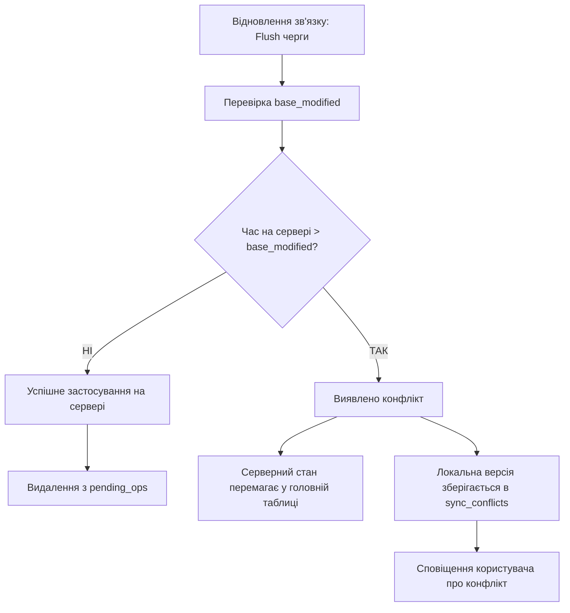

# Офлайн-зміни, черга операцій та вирішення конфліктів

Цей документ визначає правила виконання операцій запису за відсутності мережевого з'єднання (вимога **R7**), механізм черги відкладених дій (`pending_ops`), політику вирішення конфліктів та аварійний експорт даних (**R8**).

---

## 1. Матриця доступності операцій в офлайні

Завдяки тому, що локальна база клієнта містить публічні PGP-ключі всіх користувачів організації та метадані-ключі v5, клієнт може перешифровувати спільні секрети навіть без доступу до інтернету.

| Операція | Робота офлайн | Механізм виконання |
|----------|---------------|-------------------|
| **Перегляд, пошук, копіювання, TOTP, autofill, passkey** | ✅ Так | Миттєво з локальної репліки без мережі. |
| **Створення нового ресурсу** | ✅ Так | Генерується клієнтський UUID v4, ресурс зберігається в локальній БД, операція додається в чергу `pending_ops`. |
| **Редагування існуючого ресурсу** | ✅ Так | Зміна застосовується локально (оптимістичний UI), операція додається в `pending_ops` із фіксацією версії `baseModified`. |
| **Видалення ресурсу (Trash)** | ✅ Так | Позначається як локально видалений, операція ставиться в чергу. |
| **Переміщення між папками, призначення тегів, обране** | ✅ Так | Зберігається локально та додається в чергу `pending_ops`. |
| **Поділ доступом (Share) / зміна прав** | 🟡 Черга | Ставиться в чергу; секрети перешифровуються публічними ключами отримувачів локально, але остаточне підтвердження прав здійснює сервер після відновлення зв'язку. |
| **Зміна мастер-парольної фрази акаунта** | ❌ Ні | Вимагає прямого двостороннього контакту з сервером. |
| **Налаштування MFA, створення нових користувачів** | ❌ Ні | Серверна адміністративна операція. |

---

## 2. Черга операцій (`pending_ops`)

Черга операцій зберігається в зашифрованій локальній базі даних клієнта:

```sql
CREATE TABLE pending_operations (
  id                   TEXT PRIMARY KEY NOT NULL,
  entity_type          TEXT NOT NULL,
  entity_id            TEXT NOT NULL,
  operation            TEXT NOT NULL, -- 'create', 'update', 'delete', 'share'
  payload              TEXT NOT NULL, -- серіалізований DTO (PGP-armored)
  base_modified        TEXT,          -- modified час ресурсу на момент початку редагування
  base_secret_modified TEXT,          -- modified час секрету на момент редагування
  created_at           INTEGER NOT NULL,
  attempts_count       INTEGER DEFAULT 0,
  last_error           TEXT
);
```

### Принципи черги:
1. **Черга переживає перезапуски:** оскільки операції зберігаються в базі SQLite / Room, перезавантаження смартфона або закриття браузера не призводить до втрати невідправлених змін.
2. **Черга не має терміну придатності:** зміни зберігаються стільки, скільки потрібно, поки не з'явиться зв'язок із сервером (через день, тиждень або місяці).
3. **Ідемпотентність:** операції створення (`create`) несуть клієнтський UUID. Якщо запит перервався через обрив зв'язку, при повторній спробі клієнт спершу перевіряє, чи не був запис уже створений на сервері.

---

## 3. Алгоритм вирішення конфліктів

Конфлікт виникає, коли один і той самий ресурс було змінено іншим користувачем на сервері за час, поки поточний пристрій перебував в офлайні.



### Правила обробки конфлікту:
1. **Сервер перемагає (Server-wins) для основного стану:** остання версія з сервера записується в таблицю `resources` та `secrets`.
2. **Дані користувача ніколи не видаляються мовчки:** відхилені локальні зміни автоматично зберігаються в спеціальній таблиці `sync_conflicts`:
   ```sql
   CREATE TABLE sync_conflicts (
     id                TEXT PRIMARY KEY NOT NULL,
     resource_id       TEXT NOT NULL,
     resource_name     TEXT NOT NULL,
     local_payload     TEXT NOT NULL,
     server_payload    TEXT NOT NULL,
     detected_at       INTEGER NOT NULL,
     resolved          INTEGER DEFAULT 0
   );
   ```
3. **Екран вирішення конфліктів:** користувачеві показується інтерфейс із порівнянням («Ваша локальна версія» vs «Версія з сервера») із можливістю:
   - перезаписати серверні дані своєю версією,
   - створити копію ресурсу як новий особистий запис,
   - відхилити локальні зміни.

---

## 4. Аварійний експорт сховища (Вимога R8)

Якщо сервер інфраструктури знищено або вимкнено назавжди, користувач повинен мати гарантовану можливість зберегти свій цифровий спадок без сторонньої допомоги.

### Механізм експорту:
- Викликається безпосередньо з локального інтерфейсу налаштувань.
- Виконується **повністю офлайн**, використовуючи лише локальні ключі та введену користувачем мастер-парольну фразу.
- **Підтримувані формати:**
  1. **KDBX 4 (KeePass):** стандартний галузевий формат, що підтримується всіма основними сторонніми менеджерами паролів (KeePassXC, Strongbox, KeePassDX).
  2. **Passly PGP-JSON:** повний автентичний зліпок бази Passly, зашифрований симетричним ключем або PGP-ключем користувача (зі збереженням історії, папок та тегів).
