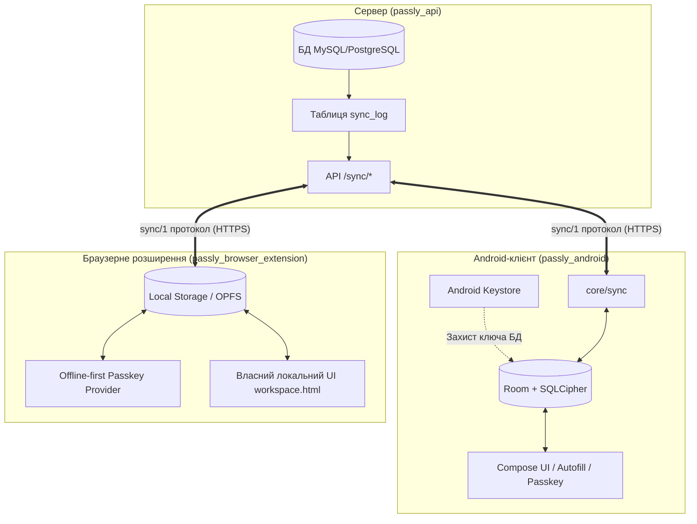

# Загальний огляд архітектури Passly

Цей документ описує концептуальну архітектуру системи **Passly**, її структурні компоненти, життєвий цикл роботи за відсутності мережевого з'єднання та базові правила проєктування.

---

## 1. Архітектурна парадигма: Автономна локальна репліка

Більшість традиційних хмарних менеджерів паролів працюють за моделлю «клієнт-сервер із кешем»: первинним джерелом істини є сервер, а клієнт лише тимчасово кешує метадані для прискорення інтерфейсу. При спробі показати пароль або у разі тривалої відсутності зв'язку клієнт блокується або вимагає підтвердження сесії.

**Passly використовує протилежну парадигму:**
- **Локальна база даних клієнта є самодостатнім, повноцінним сховищем.** У ній зберігаються всі сутності: метадані, структури папок, теги, права доступу, публічні ключі користувачів і, найголовніше, **самі зашифровані секрети**.
- **Сервер (`passly_api`) виступає виключно ретранслятором і транспортом** для доставки змін між різними пристроями користувачів команди, а також централізованим шлюзом для керування доступом і реєстрації нових учасників.
- Відсутність зв'язку з сервером жодним чином не зменшує функціональність клієнта: користувач може відкривати застосунок, шукати записи, переглядати й копіювати секрети, генерувати одноразові коди (TOTP), використовувати автозаповнення та проходити перевірки WebAuthn / Passkey.



---

## 2. Стратегічні рішення

### 2.1 Відмова від сумісності з ванільним Passbolt
Оскільки команда повністю контролює як клієнтські застосунки, так і бекенд (`Svaroh/passly_api`, `Svaroh/passly_android`, `Svaroh/passly_browser_extension`, `Svaroh/passly_styleguide`):
- Протокол синхронізації та структура збереження даних проєктуються оптимально для автономності, без компромісів заради підтримки старого ванільного API.
- Замість ненадійного відстеження змін за датами `modified` створено повноцінний **журнал змін (`sync_log`)** на стороні сервера.
- Старі сценарії масового перезавантаження даних усуваються на користь інкрементальної дельти та автономного початкового завантаження (`bootstrap`).
- Мінімальна підтримувана версія сервера фіксується у клієнтах; спроба підключитися до непідтримуваного сервера вважається помилкою конфігурації.

---

## 3. Анти-вимоги (чого категорично не повинно бути в коді)

Для забезпечення абсолютної автономності встановлено жорсткі обмеження для кодової бази:

1. **Жодного TTL на локальні дані:** записи та розшифровані блоби секретів у локальній базі не мають терміну придатності та не видаляються за таймером.
2. **Жодного віддаленого стирання (remote wipe):** сервер не має API-механізмів для віддаленого очищення клієнтської бази даних. Видалення бази можливе лише за явної, усвідомленої дії користувача на фізичному пристрої.
3. **Жодного блокування через прострочену сесію:** закінчення терміну дії серверної сесії, JWT-токена або MFA-челенджу впливає виключно на можливість отримання свіжих оновлень із сервера, але ніколи не блокує перегляд або локальне редагування даних.
4. **Жодної залежності від годинника сервера:** для доступу до локального сховища годинник сервера не використовується. Обчислення TOTP базується виключно на локальному системному часі пристрою.
5. **Ключ шифрування бази даних не прив'язується до біометричних шаблонів:** зміна або додавання відбитка пальця / Face Unlock в ОС не повинна інвалідувати мастер-ключ локальної бази даних (інакше користувач безповоротно втратив би сховище офлайн).
6. **Жодного автостирання при серверних помилках:** відповіді `401 Unauthorized`, `403 Forbidden`, `404 Not Found` чи статус «користувача видалено» не призводять до автоматичного видалення локальної бази. Клієнт переходить у стан призупиненої синхронізації з відповідним попередженням у налаштуваннях.
7. **Міграції бази даних виконуються повністю офлайн:** оновлення версії застосунку не потребує обов'язкового першого підключення до мережі для оновлення схеми Room чи IndexedDB.

---

## 4. Життєвий цикл автономної роботи

У разі повної ізоляції або остаточного вимкнення сервера застосунок забезпечує безперервне функціонування:

```
Синхронізовано ──► Сервер вимкнено / Відсутня мережа
    │
    ├── Запуск застосунку         ──► Локальне розблокування (парольна фраза / біометрія)
    │                                  (без очікування таймаутів мережі)
    │
    ├── Перегляд / Пошук / Деталі ──► Читання з локальної репліки
    │
    ├── Копіювання / Показ пароля ──► Локальне розшифрування PGP-блобу в пам'яті
    │
    ├── Генерація TOTP            ──► Локальне обчислення за системним годинником
    │
    ├── Autofill та Passkey       ──► Надання облікових даних безпосередньо з локальної БД
    │
    ├── Створення та редагування  ──► Збереження в локальній БД + додавання в чергу pending_ops
    │
    ├── Спроба синхронізації      ──► Статус «Не синхронізовано», експоненційний backoff,
    │                                  інтерфейс продовжує працювати без блокувань
    │
    └── Експорт сховища (R8)      ──► Створення резервної зашифрованої копії файлу
```

---

## 5. Структура робочого простору та компоненти

Репозиторій Passly об'єднує чотири взаємопов'язані проєкти:

- **`passly_android/`**: Мобільний клієнт для Android (Kotlin, Jetpack Compose, Room, SQLCipher, gopenpgp, Passkey Provider).
- **`passly_api/`**: Серверна частина (CakePHP, PHP 8+, MySQL/PostgreSQL), що містить плагіни `PassboltCe/Sync` (дельта-протокол) та `PassboltCe/OfflineMode` (безстрокові офлайн-налаштування).
- **`passly_browser_extension/`**: Розширення для браузерів Chrome, Firefox, Safari (JavaScript/React, Webpack, WebCrypto, OPFS/Local Storage, власний offline-first UI).
- **`passly_styleguide/`**: Спільна дизайн-система та бібліотека React-компонентів, адаптована для автономної роботи та біометричної автентифікації.
