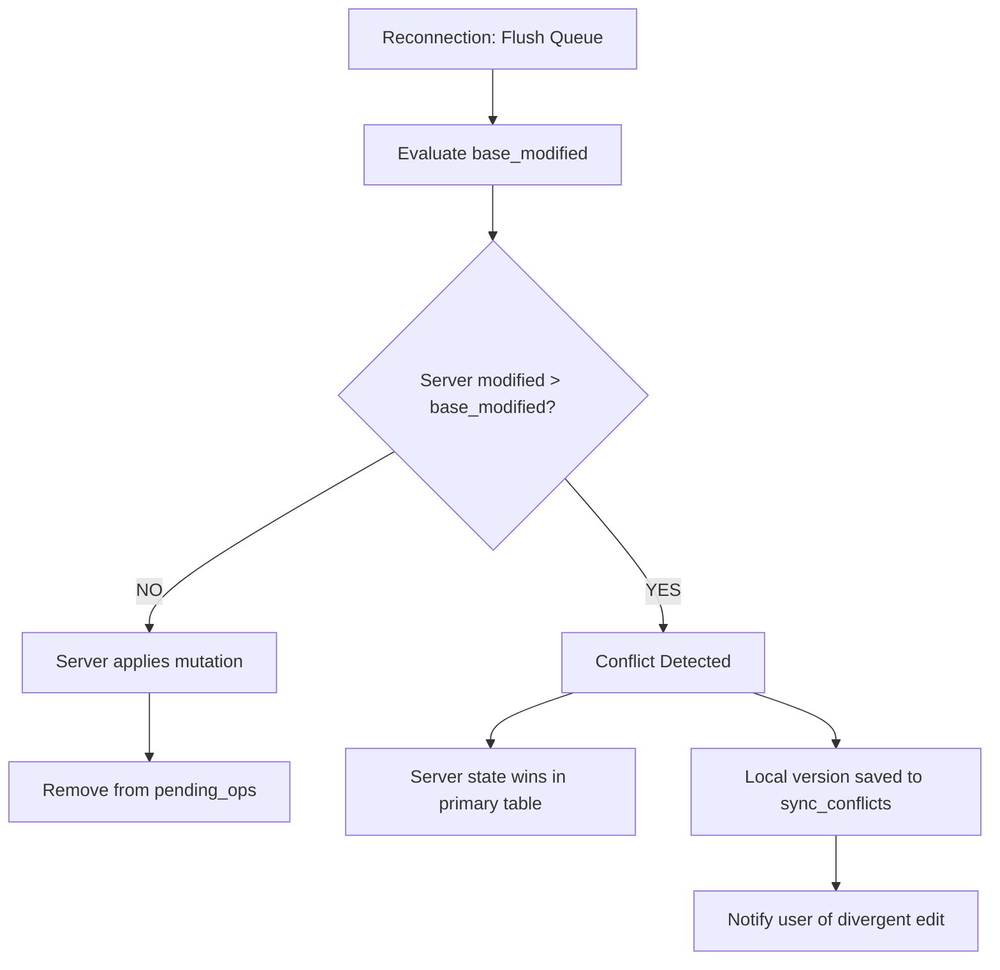

# Offline Writes, Pending Operations, & Conflict Resolution

This document specifies the rules for executing write operations while disconnected from the server (requirement **R7**), the architecture of the pending operations queue (`pending_ops`), the conflict resolution strategy, and the emergency data export mechanism (**R8**).

---

## 1. Offline Operation Availability Matrix

Because the client's local database contains the public OpenPGP keys of all organization users and v5 metadata keys, the client can re-encrypt shared entries even without an active internet connection.

| Operation | Offline Support | Execution Pattern |
|-----------|-----------------|-------------------|
| **View, search, copy, TOTP, autofill, passkeys** | ✅ Yes | Executed immediately from the local replica. |
| **Create new resource** | ✅ Yes | Generates client-side UUID v4, saves to local DB, and enqueues creation in `pending_ops`. |
| **Edit existing resource** | ✅ Yes | Applies locally (optimistic UI), enqueues modification in `pending_ops` capturing `baseModified`. |
| **Delete resource (Trash)** | ✅ Yes | Marks locally as deleted, enqueues deletion in `pending_ops`. |
| **Folder moves, tagging, favorites** | ✅ Yes | Updated locally and enqueued in `pending_ops`. |
| **Share resource / change permissions** | 🟡 Queued | Re-encrypted locally with recipient public keys; queued for server validation upon reconnection. |
| **Change master passphrase** | ❌ No | Requires a live bidirectional handshake with the server. |
| **MFA configuration, user administration** | ❌ No | Server-side administrative operations. |

---

## 2. Pending Operations Queue (`pending_ops`)

Pending mutations are persisted in the encrypted local database:

```sql
CREATE TABLE pending_operations (
  id                   TEXT PRIMARY KEY NOT NULL,
  entity_type          TEXT NOT NULL,
  entity_id            TEXT NOT NULL,
  operation            TEXT NOT NULL, -- 'create', 'update', 'delete', 'share'
  payload              TEXT NOT NULL, -- serialized DTO (PGP-armored)
  base_modified        TEXT,          -- resource modified timestamp when edit began
  base_secret_modified TEXT,          -- secret modified timestamp when edit began
  created_at           INTEGER NOT NULL,
  attempts_count       INTEGER DEFAULT 0,
  last_error           TEXT
);
```

### Queue Guarantees:
1. **Crash & Restart Resilience:** Stored in SQLite/Room; device reboots or browser process terminations never drop queued actions.
2. **No Expiration:** Pending operations do not expire; they persist until connectivity is re-established (days, weeks, or months later).
3. **Idempotency:** Creation events use client-generated UUIDs. If a connection drops during transit, the client verifies whether the ID already landed before re-submitting.

---

## 3. Conflict Resolution Strategy

A conflict occurs when an entry modified offline has also been updated on the server by another team member in the interim.



### Conflict Rules:
1. **Server Wins for Primary State:** The authoritative server state takes precedence in `resources` and `secrets` to maintain team consistency.
2. **Zero Silent Data Loss:** Divergent local changes are preserved in a dedicated `sync_conflicts` table:
   ```sql
   CREATE TABLE sync_conflicts (
     id                TEXT PRIMARY KEY NOT NULL,
     resource_id       TEXT NOT NULL,
     resource_name     TEXT NOT NULL,
     local_payload     TEXT NOT NULL,
     server_payload    TEXT NOT NULL,
     detected_at       INTEGER NOT NULL,
     resolved          INTEGER DEFAULT 0
   );
   ```
3. **Resolution UI:** The user is alerted with a side-by-side comparison ("Your Offline Changes" vs "Server Version") with options to:
   - Overwrite the server with their local version,
   - Save the local version as a new separate entry,
   - Discard the local divergence.

---

## 4. Emergency Vault Export (Requirement R8)

If an organization's server infrastructure is permanently destroyed or decommissioned, users must have a guaranteed method to extract their vault data independently.

### Export Implementation:
- Initiated directly from local Settings.
- Executes **entirely offline** using locally cached keys and the user's master passphrase.
- **Export Formats:**
  1. **KDBX 4 (KeePass):** Standard password database format supported by common offline managers (KeePassXC, Strongbox, KeePassDX).
  2. **Passly PGP-JSON:** Full cryptographic snapshot of the Passly vault, encrypted with a user passphrase or PGP key, preserving tags, folders, and metadata.
