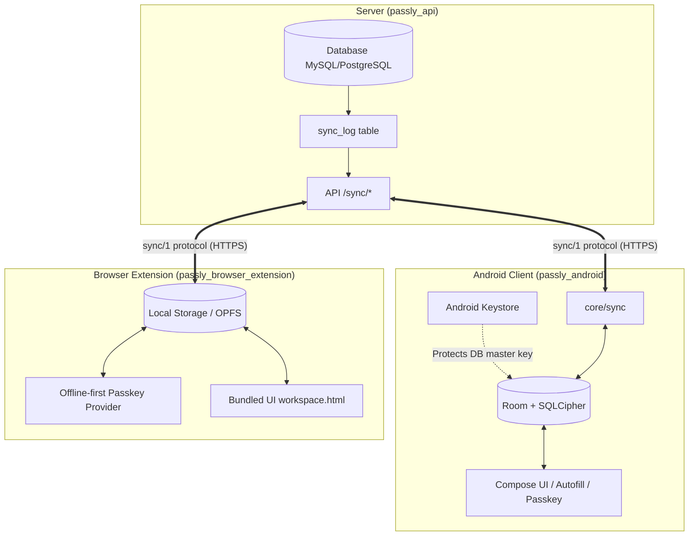

# System Architecture Overview

This document outlines the conceptual architecture of **Passly**, its primary components, offline lifecycle, and governing engineering invariants.

---

## 1. Architectural Paradigm: Autonomous Local Replica

Traditional cloud-connected password managers adhere to a "client-server with cache" pattern: the remote server is the primary source of truth, and the client temporarily caches metadata to make the UI responsive. When a user reveals a password or goes offline for an extended period, the client blocks or demands server re-authentication.

**Passly inverts this paradigm:**
- **The client's local database is a fully self-sufficient replica store.** It stores all domain entities: metadata, folder trees, tags, permissions, public keys of all users, and critically, **the encrypted secrets themselves**.
- **The backend server (`passly_api`) acts strictly as a transport and relay** for delivering change events between a team's devices, as well as a centralized gateway for user provisioning and initial access granting.
- Server unavailability does not degrade client capabilities: users can launch the application, search, inspect entries, reveal and copy passwords, compute TOTP codes, and execute Autofill and WebAuthn / Passkey ceremonies entirely offline.



---

## 2. Strategic Decisions

### 2.1 Dropping Vanilla Passbolt Compatibility
Because the Passly team controls both the client applications and the backend server (`Svaroh/passly_api`, `Svaroh/passly_android`, `Svaroh/passly_browser_extension`, `Svaroh/passly_styleguide`):
- The sync protocol and local persistence models are architected cleanly for autonomy without compromise or backward compatibility shims for legacy upstream APIs.
- Instead of brittle timestamp heuristics, a dedicated **server change journal (`sync_log`)** provides monotonic delta tracking.
- Legacy full-refresh flows (`HomeDataInteractor` / `FullDataRefreshExecutor`) are being phased out in favour of incremental deltas and clean bootstrap snapshots.
- A minimum required server version is enforced; an outdated server is treated as a configuration error rather than triggering a degraded fallback mode.

---

## 3. Architectural Anti-Requirements

To ensure absolute autonomy, the following invariants are strictly enforced across the codebase:

1. **No TTL on local data:** Records and encrypted secret blobs in the local database never expire or get cleared on a timer.
2. **No remote wiping:** The server has no mechanism to trigger client-side data purging. Wiping local data is exclusively an intentional, explicit user action on the physical device.
3. **No session gating:** Expired HTTP sessions, JWTs, or MFA prompts only pause network synchronization; they never block local read or write access.
4. **No reliance on server time:** Accessing the local store does not depend on server clock synchronisation. TOTP generation relies exclusively on the device's system clock.
5. **Database encryption key is not bound to biometrics:** Adding or modifying biometric credentials (fingerprints / Face Unlock) in the OS must not invalidate the database master key (which would permanently lock out an offline user).
6. **No auto-wipe on server error codes:** HTTP responses such as `401 Unauthorized`, `403 Forbidden`, `404 Not Found`, or "user deleted" never wipe local data. The client simply enters a paused sync state with a non-intrusive warning.
7. **Database migrations are fully offline:** Upgrading the application version never requires an active internet connection to execute Room or IndexedDB schema migrations.

---

## 4. Autonomous Lifecycle

In the event of an extended network outage or permanent server shutdown, the application continues to operate seamlessly:

```
Synchronised ──► Server permanently offline / No network
    │
    ├── Application launch      ──► Local unlock (passphrase / biometric)
    │                                (zero network timeout delays)
    │
    ├── Browse / Search / Inspect──► Served from local replica
    │
    ├── Copy / Reveal password  ──► In-memory PGP decrypt of local armored blob
    │
    ├── TOTP generation         ──► Local computation via system clock
    │
    ├── Autofill & Passkeys      ──► Credentials served directly from local DB
    │
    ├── Create / Edit entries   ──► Saved locally + queued in pending_ops
    │
    ├── Synchronisation attempt ──► Status "Offline", exponential backoff,
    │                                UI remains unblocked and fully functional
    │
    └── Export replica (R8)     ──► Encrypted standalone backup file generation
```

---

## 5. Workspace Layout & Component Roles

The Passly codebase is divided into four interdependent subprojects:

- **`passly_android/`**: Native Android client (Kotlin, Jetpack Compose, Room, SQLCipher, gopenpgp, Passkey Provider).
- **`passly_api/`**: Backend API (CakePHP, PHP 8+, MySQL/PostgreSQL) hosting `PassboltCe/Sync` (delta protocol) and `PassboltCe/OfflineMode` (perpetual offline policies).
- **`passly_browser_extension/`**: Multi-browser extension for Chrome MV3, Firefox, and Safari (JavaScript/React, Webpack, WebCrypto, OPFS/Local Storage, bundled offline workspace).
- **`passly_styleguide/`**: Shared design system and React component library, optimized for offline interactions and biometric unlock workflows.
